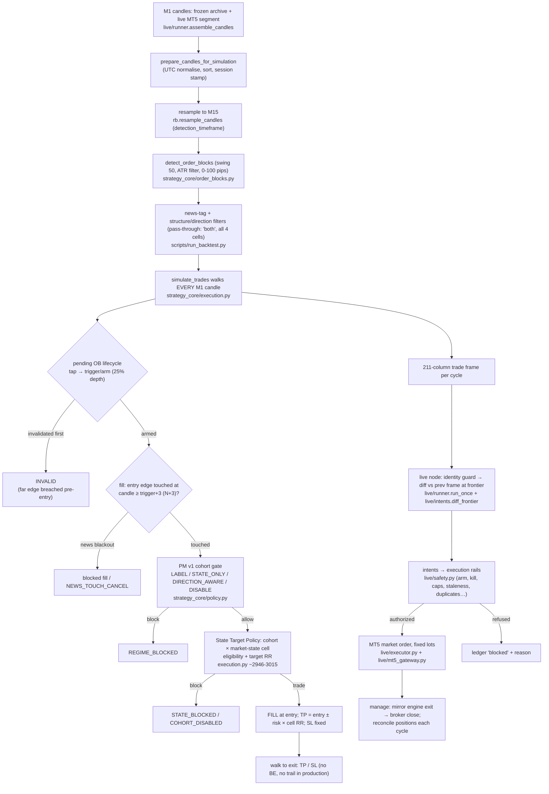

# TRADING-SYSTEM-LOGIC — the canonical explanation of the trading brain

**Verified against code, config, tests and production artifacts on 2026-10-17**
(not reconstructed from conversational memory). Authority commits:

| component | commit / identity |
|---|---|
| Lux engine (production) | `FX-OB-Backtester` @ **`b276f15f874d051012f24e06208293bf18a44fd1`** (`golden-run-001-engine`), governed manifest **`196acb79847f…`** (30 files, `live/engine_identity.py`) |
| Control Tower / live node (production) | `live-trading-control-tower_emergent-main` @ **`97ebf991a2346bbff84ba358a609de0c7da243ce`** (`hardening/m3-p1-production-fixes`) |
| Strategy authority | `strategy/production_strategy.v1.json` → runtime cache `generated_configs/d6cdae589b1e4c37a67763253c466067.json`, sha/strategy-digest **`da181e9b8b04bf86…`** |
| Portfolio policy | `configs/policy/deployed_policy.v1.json`, version `2026-07-09.te-v1.2-surgical-disable` |

Everything marked **PRODUCTION** below is what those bytes do. Everything
marked **WIP / SHADOW / DORMANT / NOT QUALIFIED** is explicitly not deployed
behaviour; §15 and §17 keep the inventory. At the time of writing the system
is PAUSED for VPS migration (see `VPS-MIGRATION-HANDOVER-20261017.md`); the
node was cleanly stopped 2026-10-17 10:50:20Z and had been `identity_frozen`
since 2026-09-03 (§17.8).

---

## 1. Strategy thesis

The strategy trades **order blocks**: when price breaks market structure
(closes through a prior swing high/low), the last opposing candle-zone before
that break — where the move originated — is treated as a footprint of
institutional orders. The thesis is that when price later **returns** to that
zone, resting interest there tends to produce a reaction in the direction of
the original break.

A potential opportunity is therefore: *a structure break on M15 creates a
zone; price later comes back, penetrates the zone deeply enough to show real
engagement (25% of its depth), and we join the expected reaction with a limit
at the zone's near edge, a stop just beyond its far edge, and a take-profit
expressed as a risk multiple.* Not every such opportunity is taken: a
research-derived matrix decides, per **session × structure-type × direction ×
daily market state**, whether that cell has historical edge and what RR it
should target — and a second, coarser cohort policy layer can veto whole
cohorts or demand trend agreement. All research/validation is EURUSD-first;
the live instrument is EURUSD only.

## 2. End-to-end decision pipeline (PRODUCTION)

Authoritative module per stage: data assembly `live/runner.py::assemble_candles`;
preparation/sessions `strategy_core/sessions.py`; detection
`strategy_core/order_blocks.py::detect_order_blocks`; simulation + all strategy
gates `strategy_core/execution.py::simulate_trades`; market state
`src/regime.py` (mirrored `strategy_core/regime.py`); PM policy
`strategy_core/policy.py` + `src/portfolio_policy.py`; cohort×state scenario
`strategy_core/scenario.py::_build_cohort_index`; news `strategy_core/news.py`
+ `live/news_feed.py`; frame diff/intents `live/intents.py::diff_frontier`;
rails `live/safety.py`; broker `live/executor.py`, `live/mt5_gateway.py`;
cycle orchestration `live/main.py` + `live/runner.py::run_once`.

The live node recomputes the FULL frame (2015→now) every closed M15 boundary
and derives intents from the frontier diff — the engine is the single
decision-maker; the node never re-implements strategy logic.

## 3. Order-block model (PRODUCTION)

**Creation** (`strategy_core/order_blocks.py`, LuxAlgo-style port):
- Swing pivots on M15 with `swing_length=50`: a bar is a swing high/low if it
  is the extreme of the 50 bars after it (pivot confirmed 50 bars later).
- A **bullish OB** is created when a close crosses ABOVE the tracked swing
  high (`previous_close <= level < current_close`); **bearish** mirrored below
  the swing low. The crossing bar is the **detection** bar
  (`detection_time`); the swing level is stored as `break_level`.
- **Structure tag:** `CHoCH` if the break flips the prevailing bias
  (tracked `swing_trend_bias`), else `BOS`. First break of a swing only
  (`crossed` latch) — one OB per swing level.
- **Zone geometry:** between pivot and detection, find the extreme
  *parsed* price (bullish: lowest `parsed_low`; bearish: highest
  `parsed_high`). That single **origin candle** (its `origin_time`) supplies
  the zone: `top = parsed_high`, `bottom = parsed_low` of that candle.
- **Parsed prices / ATR requirement:** candles whose range ≥ 2 × ATR(200)
  (Wilder RMA of true range; `ob_filter="Atr"`) have high/low swapped-out so
  freak candles cannot define a zone. Size filter: width 0–100 pips passes
  (`min_ob_size_pips=0`, `max_ob_size_pips=100`).
- **Proximal/distal:** for a bullish OB the proximal (entry) edge is `top`
  and the distal (stop-side) edge is `bottom`; for bearish, proximal =
  `bottom`, distal = `top`.

**Identity:** run-local `ob_id` is ordinal and window-relative — NEVER
durable. Durable identity is the CAP-5 fingerprint: sha256 over
`field=value|…` of [origin_time, detection_time, direction, structure_tag,
top, bottom] with prices `Decimal(str(v)).quantize(0.00001)`, UTC
`%Y-%m-%dT%H:%M:%SZ`, enums lowercased (`live/active_ob_store.py` on the
dormant store branch; spec history: `docs/capacity/ORDER-BLOCK-IDENTITY.md`
on `capacity/m-capacity-consolidate-1`).

**Lifecycle (engine vocabulary — per-run, inside one simulation):**
1. **Pending/RESTING** — admitted when the walk reaches `detection_time`; a
   plan (entry/stop/TP) is pre-computed. Accumulates metrics
   (`max_distance_away_before_fill_price`) and optional **tap** state (price
   enters the zone without reaching the arm depth: `tapped_time`,
   `tapped_candle_index`, `tapped_before_trigger`).
2. **Triggered/ARMED** — price penetrates ≥ **25%** of zone depth from the
   proximal edge (`triggered_edge_trigger_thresholds=[25]`): stamps
   `trigger_time/_candle_index`, `armed_at`, `armed_same_candle`,
   `armed_on_trigger_candle`, and delay-window state (`_dw`).
3. **FILLED/ACTIVE** — entry edge touched on a candle with
   `candle_index ≥ trigger_candle_index + 3` (**N+3**, §9). Open trade
   carries row + BE bookkeeping fields.
4. Terminal: **WIN / LOSS** (TP/SL), **INVALID**
   (`invalidated_before_edge_entry`: a candle breaches the DISTAL edge while
   pending — bullish `low < bottom`, bearish `high > top`), **UNFILLED**
   (`never_triggered` / `never_filled_after_trigger` at frame end), **OPEN**
   (still active at frontier), **REGIME_BLOCKED / STATE_BLOCKED /
   COHORT_DISABLED** (policy refusals at the would-be fill),
   **NEWS_TOUCH_CANCEL** (entry touched during a blackout with
   `news_cancel_if_touched_during_blackout=true`).
- **No age expiry.** A lifecycle-valid block is retained regardless of age
  (measured max actionable age 4.58 years; the 2018 specimen
  `00a226de5c11…` was still RESTING in 2026).
- **Retest/touch:** the fill IS the retest — a limit at the proximal edge
  after arming. Optional revisit-confirmation machinery exists
  (`require_revisit_confirmation`) but is OFF in production.
- **Persistence across cycles/restarts:** NONE in the production engine — each
  cycle recomputes the full history deterministically, which is what makes
  statelessness safe (and slow — §17.1). The continuity architecture for a
  bounded future is DORMANT/NOT QUALIFIED (§13, §17).

## 4. LONG vs SHORT decision (all layers, in order)

Direction starts at the OB itself (bullish OB ⇒ candidate LONG at its top
edge; bearish ⇒ candidate SHORT at its bottom edge) and must then survive
these gates, applied **at the would-be fill moment** in this order
(`strategy_core/execution.py`; order documented in code at ~line 2952):

| # | layer | PRODUCTION setting | can it refuse a direction? |
|---|---|---|---|
| 1 | structure/direction pre-filter (`allowed_structure_directions`, `trade_direction`, `structure_filter`) | all four cells allowed, `both`, symmetric | capable, but pass-through today |
| 2 | session filter (`session_filter_enabled`, `allowed_sessions`) | **disabled** | no (sessions act via cohorts instead) |
| 3 | news blackout (§12) | enabled | yes — but direction-blind |
| 4 | **Portfolio policy v1** (cohort = instrument×session×structure×direction; `strategy_core/policy.py::decide`) | `enforce` | **yes** — `DISABLE` kills the cohort; `DIRECTION_AWARE` requires trend agreement: Bull state→Long only, Bear→Short only, **Chop→both**; `STATE_ONLY` blocks `*/Chop` days both directions; `LABEL` never blocks. Refusal ⇒ `REGIME_BLOCKED` (`direction_mismatch` / `state_not_allowed` / `portfolio_disabled`) |
| 5 | **State Target Policy** cell (session×structure×direction×market-state; `strategy_core/scenario.py` + execution ~2946-3015) | enabled (`session_strategy_scenario`) | **yes** — per-cell `block` ⇒ `STATE_BLOCKED`; a state-level `allow` can rescue a state inside a disabled cohort base. Unconfirmed/warmup state ⇒ cohort BASE eligibility (labels never invented) |
| 6 | execution-mode slot | `allow_multi_position` | no (no slot contention in production mode; the live cap is a rail, §11) |

So: **a long is taken only when a bullish OB arms and fills in a (session,
BOS/CHoCH) cohort whose PM policy admits longs in today's market state AND
whose cohort×state cell is eligible.** There is no separate "bias engine" —
direction preference is entirely encoded in those two research-derived
tables. Example: deployed EURUSD `newYork|bos_long` is `DISABLE` (longs never
trade NY BOS) while `newYork|bos_short` is `LABEL` (shorts always pass layer
4) — a deliberate asymmetry from walk-forward research.

## 5. The "portfolio manager" — what it actually is

What memory calls the *portfolio manager* is **Portfolio Manager v1**: a
static, research-derived, versioned **policy table**, not a runtime
prioritiser. Real names and locations:

- **Policy artifact:** `configs/policy/deployed_policy.v1.json`
  (`2026-07-09.te-v1.2-surgical-disable`), checksum-guarded, mirrored
  read-only to the research frontend (`scripts/mirror_portfolio_policy.py`,
  `configs/policy/README.md`).
- **Decision code:** `strategy_core/policy.py` (`canonical_session`,
  `cohort_key`, `decide`) invoked from the fill path in
  `strategy_core/execution.py`; loader `src/portfolio_policy.py`.
- **Inputs:** cohort key `INSTRUMENT|session|cell` (e.g.
  `EURUSD|newYork|bos_short`; 48 cohorts = 2 instruments × 6 sessions × 4
  structure-direction cells) + today's leakage-safe market state.
- **Outputs:** one whole-cohort regime policy — `LABEL`, `STATE_ONLY`,
  `DIRECTION_AWARE`, or `DISABLE` — plus audit columns
  (`portfolio_policy_version`, `portfolio_decision_reason`,
  `portfolio_cohort_key`, confidence).

What it **owns**: per-cohort tradeability and the trend-agreement rule. What
it does **not** do: it does not rank or choose between competing
opportunities, does not manage exposure, does not select or change targets,
does not consider existing positions, and does not size. There is **no
runtime portfolio optimiser**. Session-differentiated behaviour arises because
cohorts are keyed by session. Competing long/short candidates are each
gated independently; in `allow_multi_position` mode both could fill (the
live max-positions rail, §11, is an operational cap, not a portfolio choice).

Two deployed EURUSD cohorts were surgically DISABLEd by the v1.2 research
(`newYork bos_long`, `london bos_short`); the full 48-cohort table with
confidence/sample sizes lives in the policy JSON. The grander "Portfolio
Manager" of `MARKET_STATE_PORTFOLIO_MANAGER_ARCHITECTURE.md` (per-cell
RR/BE/risk matrix, Edge Monitor, Strategy Doctor) is the TARGET architecture:
its tradeability+target slice arrived as the State Target Policy (§8); the
rest (per-cell risk/BE, Edge Monitor) is FUTURE/not built.

## 6. Session logic (PRODUCTION)

Single source of truth: `strategy_core/sessions.py` — **Europe/London
wall-clock** windows (M-SESSION-DST-1), DST-correct via `zoneinfo` (never a
fixed UTC offset; the pre-fix engine classified on raw UTC hour, a defect for
~7 months/year):

| session key | label | London local hours |
|---|---|---|
| `asia` | Asia | 00:00–07:00 |
| `london` | London | 07:00–10:00 |
| `lull` | London Lull | 10:00–12:00 |
| `newYork` | New York | 12:00–15:00 |
| `ny_pm` | NY PM | 15:00–17:00 |
| `outside` | Outside | everything else |

These labels are phases of a **London trading day** — `newYork` is
deliberately NOT America/New_York local time (operator-confirmed 2026-08-07).
The session of the **fill candle** keys both the exported `fill_session`
label and the cohort/cell lookups.

What sessions change: **eligibility and target RR only**, via the cohort (§5)
and cell (§8) tables. What sessions do NOT change (flagged explicitly, in
case memory says otherwise): entry mechanics, arm threshold, N+3, stop
placement, risk size, news windows — none are session-dependent; and the
blunt `allowed_sessions` filter is disabled. There is no special transition
behaviour: each fill is classified by its own candle's session; a position
held across a boundary keeps its original cohort.

## 7. Market-state / regime logic (PRODUCTION)

`src/regime.py` (canonical; parity-locked JS mirror for the research UI).
Computed on the **daily** timeframe, stamped `regime-1.0.0`:

| indicator | params | axis |
|---|---|---|
| EMA200 vs price | length 200 | Bull / Bear |
| Bollinger Band Width | length 20, std 2.0, EUR threshold 2.342 | Expand / Compress |
| Wilder ADX | length 14, threshold 18 | Chop (ADX<18) overrides volatility |

Six states: `Bull/Expand`, `Bull/Compress`, `Bull/Chop`, `Bear/Expand`,
`Bear/Compress`, `Bear/Chop`. **Leakage-safe by construction:** the state for
day T is built only from candles that closed ≤ T−1 (`shiftedDays=1`,
`knownAt`); warmup/unknown/unconfirmed → `null`, treated downstream as
**allowed** with BASE behaviour — the system never blocks for lack of a
confident label, and never invents one.

Downstream consumers (the complete list): PM v1 `STATE_ONLY` (blocks
`*/Chop`) and `DIRECTION_AWARE` (Bull→Long, Bear→Short, Chop→both); the State
Target Policy's per-cell eligibility and RR override (§8); and trade-frame
audit columns (`market_state`, `trend_state`, `volatility_state`,
`chop_state`, `state_known_at`, `state_confirmed`). Nothing else — market
state does not alter entries, stops, news or risk.

## 8. Target selection (PRODUCTION) — **RR=2 is NOT the strategy**

TP is always `entry ± risk × RR` (risk = |entry − stop|). The RR comes from a
three-level resolution at fill time (`strategy_core/execution.py` ~2999-3015;
TP and `rr_multiple` are recomputed on the row and plan; **entry, stop and
risk never move**):

1. **Cohort × market-state override** — `state_overrides[state].rr` from the
   State Target Policy (`session_strategy_scenario` in the strategy
   authority; built by `strategy_core/scenario.py::_build_cohort_index`).
   Applied only when the state is **confirmed**. 78 custom cells; 15 distinct
   RRs from 0.5 to 4.5 (e.g. `lull CHoCH Short × Bull/Expand → 4.5`;
   `newYork BOS Short × Bull/Chop → 2.5`).
2. **Cohort base target** — `target.rr`, currently 2.0 for all 24 EURUSD
   cohorts; used when the cell has no override or the state is unconfirmed.
3. **Engine default `rr_multiple=2`** — unreachable for labelled candidates
   (every cohort carries a target); reached only by design in the
   unconfirmed-state fallback path via (2).

The same table owns per-cell **eligibility**: 144 cells = 24 cohorts × 6
states; **82 traded, 62 blocked** (`STATE_BLOCKED`, reason
`state_target_block`); a state-level `allow` can rescue a cell inside a
disabled cohort (`state_eligibility="rescued"`). Provenance:
`strategy/STRATEGY-AUTHORITY.md` — the 2026-07-03 "global RR2" conclusion is
**superseded** (2026-07-11, commit `6be5bbb`; research:
`STATE-TARGET-DISCOVERY-STUDY-1.md`, 3,213-row ladder).

No other target types exist in production: no structure/liquidity targets, no
session-specific target *mechanics* (only per-cell RRs), no fallback-less
case (level 2/3 always yields a target), and **targets never change after
entry** (BE/trailing/risk-reduction machinery exists but is disabled — §10).
`target_set` (multi-target analytics columns) is empty in production.

## 9. Entry and stop-loss logic (PRODUCTION)

Entry model: **`triggered_edge`** (the only one in `entry_models`), scenario
`entry_triggered_edge_25p0_d3`:

- **Arm threshold:** price must penetrate **25%** of zone depth from the
  proximal edge (`entry_threshold_pct=25`). Depth = `top − bottom`.
  Bullish: `low ≤ top − 0.25×depth`; bearish mirrored.
- **Entry price:** the proximal edge itself
  (`triggered_edge_entry_level_pct=0` ⇒ bullish entry = `ob.top`, bearish
  entry = `ob.bottom`; `_planned_trade`, execution.py:676).
- **N+3 delay:** fill is legal only on a candle with
  `candle_index ≥ trigger_candle_index + 3`
  (`triggered_edge_delay_candles=3`). On M1 execution candles that is three
  minutes after the trigger candle. The first legal candle that *touches*
  the entry price fills at the entry price. Pinned semantics: C0 = trigger
  candle, C3 = first legally eligible fill candle; restart/resume cannot turn
  N+3 into N+2 or N+4 (requal package evidence). Whether operator intent was
  N+4 is an explicitly parked policy question — do not "fix" silently.
- **Stop:** distal edge ± 1-pip buffer (`stop_buffer_pips=1`): bullish stop
  = `bottom − 0.0001`, bearish = `top + 0.0001`. Fixed for the life of the
  trade.
- **Invalidation before entry:** any pending candle breaching the distal edge
  (bullish `low < bottom`; bearish `high > top`) cancels the setup
  (`INVALID`, `invalidated_before_edge_entry`, `cancelled_before_entry=True`)
  — even between trigger and N+3.
- Optional cancel knobs all OFF in production: retrace-cancel,
  first-failed-tag cancel, fail-fast-touch filters, reverse-touch cancel.
- **Stale opportunity handling is NOT an engine concept** — the engine fills
  at the modelled bar regardless of wall-clock. Staleness is an execution
  rail (§11): the live node refuses to SUBMIT an open whose modelled fill is
  older than **900 s** (`stale_open_wallclock`).

## 10. Position / trade management

**Engine (strategy) — PRODUCTION:** after fill, nothing moves. SL and TP are
static; the trade walks candle-by-candle to whichever is touched first (a
same-candle touch of both resolves pessimistically as LOSS via the wick
basis). Implemented-but-DISABLED machinery, selectable per run/cohort:
break-even (`be_enabled=false`; faithfully researched and **rejected** —
Phase B2), run-level risk-reduction move-stop
(`risk_reduction_*`, null), protections (`protection_modes=["baseline"]` ⇒
none), partial exits: none exist anywhere.

**Live node (operational) — PRODUCTION:** `live/intents.py::diff_frontier`
turns frame transitions into intents: an engine fill at the frontier ⇒ OPEN
intent (market order, fixed lots, SL/TP attached:
`executor.py::...open_position(side, fixed_risk_lots, sl, tp)`); an engine
exit on a mirrored position ⇒ CLOSE intent; broker-side closes (TP/SL hit at
MT5) are reconciled back (`broker_closed`). MT5 executes the attached SL/TP
server-side between cycles, so intra-cycle exits do not wait for the node.
Operator controls (Control Tower / CLI, not strategy): arm/disarm
(`live/arming.py`, arm token), kill switch (KILL file), MAINTENANCE marker
(launcher stand-down), submission disable, manual close at the broker
(reconciliation then records it). Mismatches are refused loudly
(`unknown_position: no mirrored ticket…`) rather than auto-healed.

## 11. Risk system

**STRATEGY risk (engine):** R semantics — 1R = |entry − stop| (zone depth +
1 pip); every outcome is expressed in R (`pnl_r`); costs modelled as spread
0.2 + slippage 0.2 pips. Equal risk per trade (Phase-D research: adaptive
sizing failed walk-forward). No exposure netting, no correlation logic.

**OPERATIONAL safety (live node, `live/safety.py` + readiness in
`live/publisher.py`) — every OPEN must pass ALL rails:** mode=live &
submission enabled · kill switch absent · symbol whitelist (EURUSD) ·
account identity observed & demo-mode expectation (`trade_mode=0`) · broker
connected · **arm authorization** (server-verified arm token;
`arm_server_mismatch` seen live 2026-08-12) · daily open cap (12/day) ·
max positions **6** · daily loss cap (R-based, `LIVE_DAILY_LOSS_LIMIT_R`) ·
news-feed freshness · reconciliation clean · duplicate-intent suppression
(ledger-keyed intent fingerprints) · **`stale_open_wallclock`: modelled fill
age ≤ 900 s — DO NOT WIDEN** (S_2108 executed 38 min stale on 08-14 is the
standing counterexample; the rail landed 08-15, `77e563e`) · entry price
divergence. **Position sizing is operational, not strategic: fixed
`LIVE_FIXED_RISK_LOTS` (default 0.01).** CLOSE/reconciliation are never
gated on news or staleness — a node that cannot exit is the worse failure.

## 12. News logic (PRODUCTION — M-LIVE-NEWS-1, `docs/NEWS-PROTECTION.md`)

> A HIGH-impact event in a currency relevant to the traded instrument blocks
> **new fills** from **T−3:00 through T+3:00 inclusive** (closed ends,
> pinned by `test_news_blackout.py`).

That is the whole rule. Mechanics: `news_block_new_fills=true`; pending
orders pause during the window (`news_pause_pending_orders=true`); an entry
touched during a blackout is cancelled (`NEWS_TOUCH_CANCEL`) rather than
filled late. **No pre-news flatten** (removed by M-LIVE-NEWS-1 at
`b276f15`); news never closes an existing position; CLOSE/MODIFY/kill are
never news-gated. Impacts: `["high"]` only; medium/low label columns only.
Live source: ForexFactory weekly JSON
(`https://nfs.faireconomy.media/ff_calendar_thisweek.json`, ~10 KB, no auth,
`NEWS_SOURCE_URL` override), refreshed per cycle with freshness telemetry —
same publisher/taxonomy as the backtest CSV
(`data/news/master_economic_calendar_2020_present.csv`). Design rule that
motivated it: **silence must never read as safety** (the old static CSV went
78.8 days stale and read as "no blackout, perfect health").

## 13. State / memory

| boundary | what persists (PRODUCTION) |
|---|---|
| M1 bar → M1 bar | everything, inside one simulation walk (pending/active items in memory) |
| M15 boundary (cycle) | NOTHING in the engine — full deterministic recompute; the NODE persists: `frames/prev_trades.csv` (diff baseline, hash-chained via `runner_state.json`), execution ledger, identity witness, daily caps, M1 live segment, news cache |
| process restart | node state above + MT5's own positions; engine state: none needed (recompute) |
| machine restart | same, plus scheduled-task supervision relaunches the node (5-min trigger; MAINTENANCE marker = fail-closed stand-down) |

**Unfinished continuity architecture (clearly separated — NOT in production):**
the bounded working set (`live/working_set.py`, `live/bounded.py`) computes a
~86-day window per cycle in **SHADOW** only (median 14.8 s vs authority
~21 min; parity 185/186 boundaries on post-floor detections); the **active-OB
store** `ct.active-ob-store.v1` (durable fingerprinted structural continuity,
36-record seed, CT commit `f75d78f`) is DORMANT — nothing imports it; the
**resumable-execution engine seam** (initial_pending/initial_active/admission
cursor/context prefix, candidate manifest **`98ec613f16caca27…`**) is
seam-validated offline but **NOT PRODUCTION-QUALIFIED** (Mac 11-year
default-path requalification outstanding; sealed package
`artifacts/resumable-execution-requal-20260818T160104Z/`); **incremental
Model-B** (`incremental/m-incremental-1`, `docs/LIVE-STATE-SCHEMA.md`)
proved detection is append-only and designed carried-state schemas — WIP.

## 14. Backtest vs live vs TradingView

| component | authoritative for |
|---|---|
| **Lux golden engine** (`strategy_core/` + driver `scripts/run_backtest.py`) | ALL strategy decisions — detection, lifecycle, gates, targets, exits. Research backtests and the live node run the SAME bytes (manifest-pinned); `strategy_core` is a pure library (`BOUNDARY.md`), the driver and node are its impure drivers |
| **Control Tower / node** (`live/`, `backend/`) | execution only: cycles, intents, rails, MT5, telemetry, reconciliation. Never re-implements strategy |
| **MT5** | fills/positions ground truth; server-side SL/TP between cycles; reconciliation treats broker state as the position authority |
| **TradingView visual oracle** (`pine/`, `tools/oracle/`) | nothing — visual verification only. M15 intrabar ordering can mis-order events vs M1; multiple numbering namespaces; chart OB numbers are never identity (join via time+direction+structure+geometry) |

## 15. Feature inventory

| Feature | Purpose | Code | Config | Status | Qualified? | Evidence |
|---|---|---|---|---|---|---|
| OB detection (swing50/ATR/0-100pip) | find zones | `strategy_core/order_blocks.py` | golden config | PRODUCTION | yes (golden parity, TV parity audit) | golden/run-001, oracle parity manifests |
| Triggered-edge entry 25%/N+3 | entry mechanics | `execution.py` (`_planned_trade`, pending loop) | `triggered_edge_*` | PRODUCTION | yes | C0–C3 pinned tests/evidence |
| 1-pip stop buffer, fixed SL/TP | exits | `execution.py` | `stop_buffer_pips=1` | PRODUCTION | yes | frame history |
| Market State engine (6 states, daily, leakage-safe) | regime label | `src/regime.py` (+`strategy_core/regime.py`) | thresholds in code | PRODUCTION | yes (fixture parity, leakage test) | `tests/regime/` |
| Portfolio policy v1 (48 cohorts) | cohort tradeability + trend agreement | `strategy_core/policy.py`, `src/portfolio_policy.py` | `deployed_policy.v1.json`, mode `enforce` | PRODUCTION | yes (walk-forward, replay validator) | policy README, PM arch §10 |
| State Target Policy (144 cells, 15 RRs) | per-cell eligibility + target RR | `strategy_core/scenario.py` + execution ~2946-3015 | `session_strategy_scenario` (authority json) | PRODUCTION | yes (ladder study + run audit) | `STATE-TARGET-DISCOVERY-*`, STRATEGY-AUTHORITY.md |
| News blackout (high, ±3min, fills only) | event risk | `strategy_core/news.py`, `live/news_feed.py` | `news_*` | PRODUCTION | yes | `test_news_blackout.py`, NEWS-PROTECTION.md |
| Sessions (London wall-clock, DST) | cohort keying | `strategy_core/sessions.py` | — | PRODUCTION | yes | M-SESSION-DST-1, dst-counterfactual artifact |
| Execution rails (arm/kill/caps/staleness/dupes/divergence) | operational safety | `live/safety.py` | env `LIVE_*` | PRODUCTION | yes | ledger incidents, readiness telemetry |
| Fixed-lot sizing 0.01 | sizing | `live/executor.py` | `LIVE_FIXED_RISK_LOTS` | PRODUCTION | yes | ledger ticket 519391729 |
| Identity guard / witness | freeze on engine/strategy drift | `live/identity_guard.py` | — | PRODUCTION | yes | frozen since 09-03 (doing its job; cause undiagnosed) |
| Break-even machinery | move stop at +R | `execution.py` (BeArmState) | `be_enabled=false` | DORMANT (researched & REJECTED, Phase B2) | n/a | PM arch doc |
| Risk-reduction move-stop | stop to +R at trigger | `execution.py` | nulls | DORMANT | no | — |
| Protections / partials / trailing | — | protections only (`baseline`=off) | — | DORMANT / NONEXISTENT | no | Phase C failed WF |
| Multi-target `target_set` columns | analytics | `execution.py` | `()` | DORMANT | n/a | — |
| Bounded working set + shadow parity | fast cycles | `live/working_set.py`, `live/bounded.py`, `live/shadow.py` | shadow-only | **SHADOW** | detection surface only | `shadow_parity.json` 185/186 |
| Active-OB continuity store | durable pre-floor OBs | `live/active_ob_store.py` etc. @ `f75d78f` | none | **DORMANT** | store contract tested; not integrated | seed `808237d8…` |
| Resumable execution seam | carry pending/active across cycles | candidate patch on `b276f15` → manifest `98ec613f…` | n/a | **NOT QUALIFIED** | seam-validated offline only | requal package + evidence/ |
| Incremental Model-B | append-only detection + carried state | `incremental/m-incremental-1` branch | n/a | **WIP** | no | LIVE-STATE-SCHEMA.md |
| TV visual oracle + strategy companion | chart verification | `pine/`, `tools/oracle/` | — | WIP (uncommitted work preserved on `wip/vps-migration-20261017-tv-oracle`) | visual only | oracle parity audit |
| GBPUSD | second instrument | policy rows exist | not in live config | EXPERIMENTAL / NOT VALIDATED | no | PM arch doc |
| Edge Monitor / Strategy Doctor / per-cell risk | decay watch, sizing | — | — | FUTURE (design only) | no | PM arch §5, §11 |

## 16. Worked examples (genuine production history, from the node's own frame
and ledger — M-LIVE-OB-NONINTERACTION-FORENSIC-1, 2026-08-19/20)

**SHORT, traded (engine) and correctly refused by a rail (live): S_2074.**
Bearish BOS detected 2026-06-05 12:30Z; zone 1.16391–1.16442 (entry 1.16391 =
bottom edge, stop 1.16452 = top + 1 pip). Price revisited 08-19: trigger/arm
12:53 (≥25% penetration), earliest legal fill 12:56 (N+3), entry touched
12:58 → fill. Session `newYork`, state Bull/Compress (confirmed): PM
`newYork|bos_short` = LABEL → pass; cell override Bull/Compress → RR 2.0; TP
1.16269. Stop hit 13:07 → **LOSS −1.10R** (engine). Live: the full-history
cycle evaluated the fill at 13:25:38 — 27.6 min old — and
`stale_open_wallclock` refused submission (correctly; §17.1 is the cause).

**LONG, traded end-to-end decision: L_2106.** Bullish OB detected 08-07
09:00Z; filled 08-12 18:11Z, session `Outside`, state Bear/Chop. PM
`outside|bos_long` = DIRECTION_AWARE: Bear would block a long, but
**Chop→both** ⇒ allowed; cell eligible; exit 08-13 06:30 → **LOSS −1.09R**
(engine). Live submission was refused by the **arm rail**
(`arm_server_mismatch`, 18:36) — an operational, not strategy, refusal.

**NO-TRADE, policy-blocked (and the policy was right): S_2072.** Bearish
CHoCH detected 06-01 13:30Z, zone 1.16739–1.16819. Tapped 08-19 14:32, armed
14:37, session `ny_pm`, state Bull/Compress. PM `ny_pm|choch_short` =
DIRECTION_AWARE ⇒ Bull state vs short = `direction_mismatch` ⇒
**REGIME_BLOCKED**, no trade. Counterfactual replay with the gate off: fill
14:41, stopped 08-20 02:03 → would have been **−1.0R**; TP never printed.

(Also instructive: S_2079 and S_2073 the same day both armed and were
`invalidated_before_edge_entry` within 1–2 minutes — price blew through the
distal edge before N+3 allowed a fill.)

## 17. Known limitations / unfinished work (exact status at freeze)

1. **Structural latency (THE open problem):** every full-authority cycle
   stage scales with the 11.5-year window — measured ~645 s pure pipeline
   (detection ~208 s, golden job ~254 s extrapolated, load/prep/news ~180 s),
   1,197 s median observed under contention; 216/219 cycles exceeded the
   900 s stale rail post-08-17, and per-M15-boundary scheduling alone adds up
   to ~15 min discovery lag — **even an instant engine cannot honour the rail
   without per-M1 cadence**. Census 07-30→08-27: 4 engine fills, 1 submitted
   (38 min stale, pre-rail), 3 refused (L_2106 arm, S_2074 + S_2113 stale).
   Target set: per-M1 cadence + cycle p95 ≤ 60 s.
2. **Bounded working set:** SHADOW only; 14.8 s median; parity covers
   post-floor detections/state panels, NOT the execution surface.
3. **Active-OB store:** DORMANT at `f75d78f`; seed `808237d8…` (36 RESTING,
   28 pre-floor, oldest 2018); not consumed by any production code.
4. **Resumable execution:** candidate `98ec613f…` fully seam-validated
   (matrix 9/9, pending/ACTIVE×211, C0–C3, JSON round-trips, ancient
   adoption, ob-138 regression, readmitted=0, ownership contract) but
   **awaiting Mac 11-year default-path requalification** — never repin or
   deploy before it passes, then shadow execution-parity, then integration.
5. **Incremental Model-B:** 10-commit WIP chain (`incremental/m-incremental-1`)
   — an alternative/complementary continuity design; not reconciled with the
   store+resume path yet.
6. **Per-M1 cadence:** designed target only; `run_once` still gates on new
   M15 boundaries.
7. **Detection-frontier skew:** 1/186 shadow-parity difference class (an OB
   detected between boundary and cycle read shows `missing_in_bounded`);
   comparison-window artifact to fix during integration.
8. **`identity_frozen` since 2026-09-03 09:19Z** (3,942 cycles): the identity
   guard refused to advance the frame — no intents, executor unreachable —
   until shutdown. **Undiagnosed.** The guard freezes on engine/config/
   strategy/policy digest drift; witness chain preserved
   (`identity_witness.json` in the migration archive). First task on any
   bring-up: diagnose before un-freezing.
9. **TradingView oracle WIP:** uncommitted-at-migration work preserved on
   `wip/vps-migration-20261017-tv-oracle` (manifests, pine, tests, tools).
10. **Live-prep freshness WIP:** `wip/vps-migration-20261017-live-prep-freshness`
    (+241/−12 telemetry freshness, server-observed phase-aware).
11. **Strategy/policy research parked:** cohort×state hierarchy beyond
    targets (failed walk-forward — revisit with more data), per-cohort
    RR/BE/risk (failed WF / rejected), GBPUSD validation, N+3-vs-N+4 operator
    intent, Edge Monitor.

## 18. Source-of-truth map ("if I want to change X, go here")

| change | go to |
|---|---|
| OB detection (swings, ATR, size) | `strategy_core/order_blocks.py` (`detect_order_blocks`), `strategy_core/swings.py`; params in the strategy authority json |
| direction policy (cohort allow/deny, trend agreement) | `configs/policy/deployed_policy.v1.json` via `scripts/mirror_portfolio_policy.py`; semantics `strategy_core/policy.py::decide` |
| per-state eligibility / **targets** | `strategy/production_strategy.v1.json` → `session_strategy_scenario` (the digest-governed authority; regenerate the runtime cache); parsing `strategy_core/scenario.py`; application `strategy_core/execution.py` ~2946-3015 |
| session boundaries / DST | `strategy_core/sessions.py` (`_SESSION_SCHEDULE`) |
| market-state definition | `src/regime.py` (+ JS mirror + fixture test) |
| entry / arm / N+3 / SL | `strategy_core/execution.py`: `_planned_trade` (676), trigger/arm & fill gates in the pending loop; config `triggered_edge_*`, `stop_buffer_pips` |
| BE / risk-reduction / protections | same file (BeArmState, `_rr_global_move_stop`, `_protection_trigger`) — all currently disabled by config |
| news rule | `strategy_core/news.py` (engine), `live/news_feed.py` (source), config `news_*`; doc `docs/NEWS-PROTECTION.md` |
| risk rails / caps / staleness | `live/safety.py` (+ `live/config.py` env knobs) — **operational; changing these is governance, not strategy tuning** |
| broker execution / sizing | `live/executor.py`, `live/mt5_gateway.py`; `LIVE_FIXED_RISK_LOTS` |
| cycle orchestration / cadence | `live/main.py`, `live/runner.py` |
| intents / frame diff | `live/intents.py::diff_frontier` |
| engine identity / pins | `live/engine_identity.py`, `live/config.py` (`ENGINE_MANIFEST_ID_EXPECTED`), `live/identity_guard.py` |
| anything engine-governed | remember: a one-byte change to a governed file moves the manifest → identity guard freezes the node → requires governed requalification. That is by design. |

## 19. Relationship to older documents (Phase-4 classification; none deleted)

**Still authoritative:** `strategy/STRATEGY-AUTHORITY.md` (the matrix IS the
strategy; supersedure of global-RR2) · `docs/NEWS-PROTECTION.md` ·
`strategy_core/BOUNDARY.md` (core/driver split) · `configs/policy/README.md`
(policy governance) · `live/VPS-SHADOW-PARITY-RULE.md`,
`live/GOLDEN-ARTEFACT-CONTRACT.md`, `live/NODE-TELEMETRY-CONTRACT.md` ·
`VPS-MIGRATION-HANDOVER-20261017.md` (migration state) ·
`docs/governance/*` (activation gates).

**Supporting / reference:** `MARKET_STATE_PORTFOLIO_MANAGER_ARCHITECTURE.md`
— excellent for market-state engine, PM v1 semantics, research rationale and
the TARGET roadmap, **but its "global RR2 deployable" conclusion and its
AS-BUILT snapshot predate the State Target Policy — read §8 here and
STRATEGY-AUTHORITY.md first** · `CONTROL-TOWER-ARCHITECTURE-V1.md` (frozen
V1 architecture + ADR rule) · `live/VPS-RUNBOOK.md`, `VPS-REQUIREMENTS.md` ·
`docs/capacity/*` and `docs/governance/*` on
`capacity/m-capacity-consolidate-1` (ENGINE-PIPELINE.md is the best prose
walkthrough of driver stages) · `docs/LIVE-STATE-SCHEMA.md` +
`docs/RESEARCH-BACKLOG.md` on `incremental/m-incremental-1` ·
requal package `REQUALIFICATION.md` + `evidence/STORE-EXECUTION-PAYLOAD-CONTRACT.md`.

**Historical (rationale-bearing; do not treat as current):**
`STATE-TARGET-DISCOVERY-STUDY-1.md` / `-RUN-AUDIT-1.md` (how the 144-cell
matrix was derived) · `PM-SERIAL-PATH-WIRING-AUDIT-1.md` ·
`docs/research/DST-POLICY-LINEAGE-AND-BLAST-RADIUS.md` ·
`docs/history/*` (blueprints) · `M3-LIVE-VERTICAL-SLICE-DESIGN.md`,
`MILESTONE-2-EXTRACTION-DESIGN.md`, `MVP-EXECUTION-PLAN.md`,
`AUDIT-AND-ROADMAP.md`, `SCOPE-LOCK.md`, `memory/PRD.md` · artifact READMEs
(dst-counterfactual RESULTS.md, active-ob-bootstrap README).

**Superseded (kept, unedited, as evidence):** the "global RR2 / whole-cohort
only" deployability box inside the PM architecture doc (superseded by
STRATEGY-AUTHORITY.md, which already carries the loud correction) · the
pre-M-LIVE-NEWS-1 flatten behaviour described anywhere · `Research
Documents/` PDFs where they conflict with the above. *Deliberately not
edited in place: the working trees were frozen for migration, and
STRATEGY-AUTHORITY.md already provides the in-repo correction pointer.*

**WIP-specific:** `docs/tradingview_visual_oracle_*.md` (oracle status
tracks the WIP branch) · `test_result.md`, `PROJECT_STATE.md` (rolling
project state; last meaningful update predates the freeze — see the
migration handover for final state).
